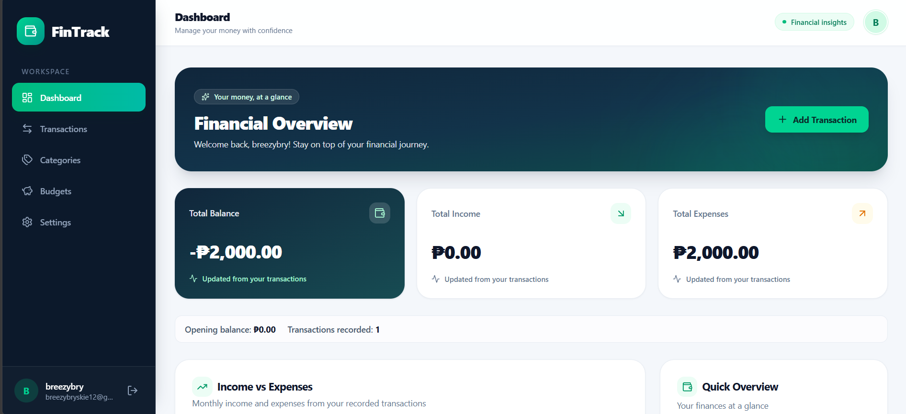
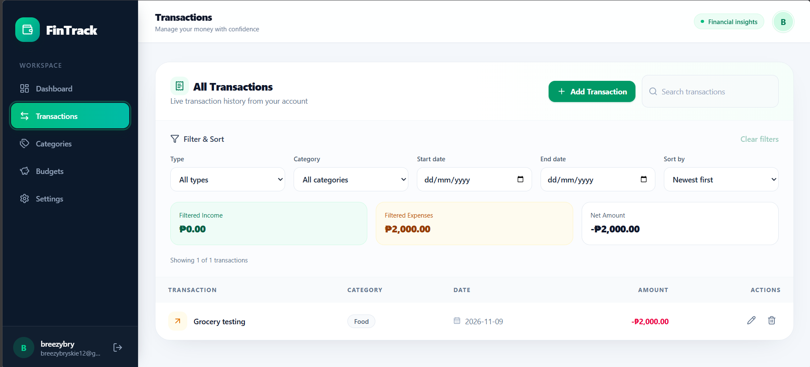
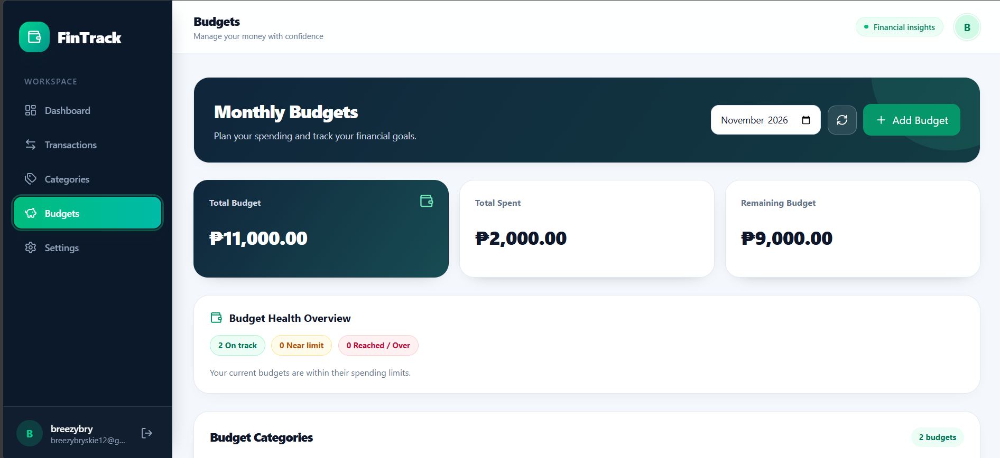
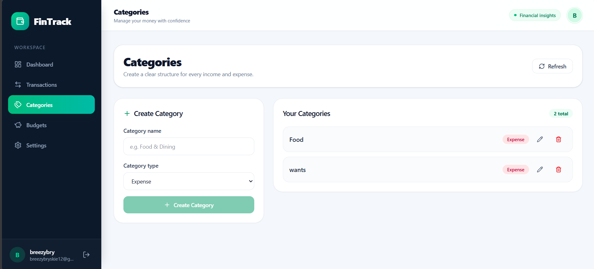
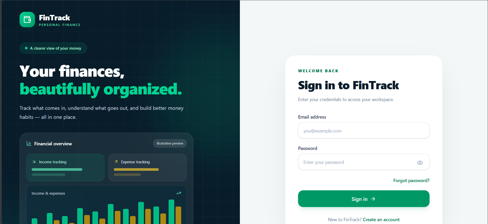

# 💰 FinTrack

### Personal Finance Management Web Application

**FinTrack** is a full-stack personal finance management application designed to help users track income, manage expenses, organize financial transactions, set spending budgets, and monitor their financial activity through an interactive dashboard.

Built with **Java, Spring Boot, PostgreSQL, React, and TypeScript**, FinTrack demonstrates RESTful API development, layered backend architecture, relational database management, authentication, authorization, and automated testing.

> **Portfolio Showcase**
>
> This public repository contains FinTrack's documentation, application screenshots, and technical overview.
>
> The complete source code is maintained in a separate private repository. Code walkthroughs or access may be provided upon request.

---

## 🖥️ Application Preview

### 📊 Dashboard



*An interactive overview of income, expenses, financial summaries, and spending activity.*

### 💳 Transaction Management



*Record and manage income and expense transactions while tracking financial activity.*

### 🎯 Budget Management



*Set monthly spending budgets, monitor expenses, and track remaining budget amounts.*

### 🏷️ Category Management



*Organize income and expense transactions into customizable categories.*

### 🔐 Login & Authentication



*Secure account access using session-based authentication powered by Spring Security.*

---

## ✨ Key Features

### 🔐 Authentication & Security

- User registration and login
- Session-based authentication using Spring Security
- BCrypt password hashing
- Six-digit OTP verification for password recovery and password changes
- Time-limited OTP codes with failed-attempt restrictions
- CSRF protection
- User-specific ownership checks for financial records

### 💳 Transaction Management

- Record income and expense transactions
- Assign transactions to appropriate categories
- View transaction history
- Edit and delete financial records
- Track financial activity over time

### 🏷️ Category Management

- Create and organize income and expense categories
- Manage existing transaction categories
- Associate transactions with relevant categories
- Organize financial records for easier tracking

### 🎯 Budget Management

- Set monthly spending budgets for expense categories
- Monitor spending against allocated budget limits
- Automatically calculate remaining budget amounts
- Identify budgets approaching or exceeding their limits
- Track budget usage through financial summaries

### 📊 Dashboard & Financial Insights

- Income and expense summaries
- Interactive financial visualizations
- Transaction-based calculations
- Spending analysis
- Budget monitoring and financial insights

---

## 🛠️ Technology Stack

| Layer | Technologies |
|---|---|
| Backend | Java 21, Spring Boot |
| Security | Spring Security, BCrypt, CSRF Protection |
| Frontend | React, TypeScript, Vite |
| Database | PostgreSQL |
| Persistence | Spring Data JPA, Hibernate |
| Database Migration | Flyway |
| Backend Build Tool | Maven |
| Frontend Tooling | Node.js, npm |
| Automated Testing | JUnit, Spring Boot Test, Node.js API Contract Tests |
| Version Control | Git, GitHub |

---

## 🏗️ System Architecture

FinTrack follows a **layered backend architecture** that separates presentation, HTTP request handling, business logic, and data persistence.

### Architecture Overview

```text
┌──────────────────────────────┐
│      React + TypeScript      │
│         Frontend UI          │
└──────────────┬───────────────┘
               │ HTTP / REST
               ▼
┌──────────────────────────────┐
│      REST Controllers        │
│   Requests and Responses     │
└──────────────┬───────────────┘
               │
               ▼
┌──────────────────────────────┐
│        Service Layer         │
│  Business Logic & Validation │
└──────────────┬───────────────┘
               │
               ▼
┌──────────────────────────────┐
│       Repository Layer       │
│        Spring Data JPA       │
└──────────────┬───────────────┘
               │
               ▼
┌──────────────────────────────┐
│      PostgreSQL Database     │
│    Persistent Data Storage   │
└──────────────────────────────┘
```

### Architecture Components

**Frontend — React + TypeScript**

Handles user interactions, navigation, forms, dashboard visualizations, and communication with backend APIs.

**Controller Layer**

Receives HTTP requests, handles API endpoints, and returns responses to the frontend.

**Service Layer**

Contains business logic for authentication, transactions, categories, budgets, and financial calculations.

**Repository Layer**

Uses Spring Data JPA to perform database operations.

**Database — PostgreSQL**

Stores registered users, financial transactions, categories, budgets, and authentication-related records.

### Backend Engineering Concepts

- RESTful API development
- Layered architecture and separation of concerns
- Dependency injection
- Object-relational mapping with JPA
- Database migrations with Flyway
- Authentication and authorization
- Transaction management
- Input validation and error handling
- Automated regression testing

---

## 🗄️ Database Design

FinTrack uses PostgreSQL as its relational database.

### Core Data Entities

| Entity | Description |
|---|---|
| Users | Stores user account and authentication information |
| Categories | Defines income and expense classifications |
| Transactions | Records income and expense activity |
| Budgets | Stores spending limits for expense categories |
| Email OTPs | Manages verification codes for password changes and recovery |

Database schema changes are managed through versioned **Flyway migrations**.

---

## 🧪 Testing & Quality Assurance

FinTrack includes automated testing and manual functional verification to support application reliability.

### Backend Testing

The backend uses **JUnit and Spring Boot Test** with Maven.

Tests cover authentication-related logic and finance application components.

### Frontend Testing

Frontend verification includes:

- TypeScript compilation
- Vite production build
- Authentication API route contract checks
- Verification of public and protected authentication endpoints

### Security Verification

The OTP verification flow was manually tested to confirm that the correct code is rejected after five incorrect verification attempts.

### Development Test Results

| Test | Result |
|---|---|
| Backend Maven test suite | Passed |
| Frontend TypeScript compilation | Passed |
| Frontend production build | Passed |
| Frontend authentication API contract tests | 2/2 Passed |
| OTP failed-attempt lockout | Passed |
| Core finance functionality | Manually verified |

These results reflect development-stage testing and do not represent an independent production security assessment.

---

## 🔒 Security Implementation

FinTrack incorporates several security measures designed to protect user accounts and financial records.

### Password Security

Passwords are stored using BCrypt hashing rather than plaintext storage.

### Session-Based Authentication

Spring Security manages authenticated sessions and protects restricted endpoints.

### CSRF Protection

CSRF tokens help protect state-changing operations against cross-site request forgery.

### OTP Verification

Password recovery and password changes use six-digit verification codes with expiration periods and failed-attempt restrictions.

### User Data Ownership

Backend ownership checks restrict financial operations to records belonging to the authenticated user.

### Environment Configuration

Database credentials and email-service configuration are managed through environment variables rather than hardcoded secrets.

> **Security Notice:** FinTrack is a portfolio application developed for learning and demonstration purposes. It has not undergone an independent production security audit.

---

## 📁 Showcase Repository Structure

This public repository contains documentation and screenshots only.

```text
FinTrack-Showcase/
├── README.md
└── screenshots/
    ├── dashboard.png
    ├── transactions.png
    ├── budgets.png
    ├── categories.png
    └── login.png
```

### Source Code Availability

The complete FinTrack source code is maintained in a separate private GitHub repository.

It includes:

- Java Spring Boot backend implementation
- React and TypeScript frontend
- PostgreSQL database migrations
- Authentication and security components
- Automated backend and frontend tests

Source-code review or technical walkthroughs may be arranged upon request.

---

## 🎯 Project Purpose

FinTrack was developed as an independent portfolio project to strengthen practical skills in Java backend development and full-stack application development.

The project focuses on:

1. Designing RESTful APIs using Java and Spring Boot.
2. Implementing authentication and authorization with Spring Security.
3. Managing relational data using PostgreSQL.
4. Applying layered architecture and separation of concerns.
5. Integrating React with Spring Boot REST services.
6. Practicing automated testing, debugging, and software maintenance.
7. Building a functional application that demonstrates backend development skills.

---

## 👨‍💻 Developer

**Bryan — Aspiring Java Backend Developer**

GitHub: [@IT-BRYYY](https://github.com/IT-BRYYY)

**Primary Technologies:** Java · Spring Boot · PostgreSQL · REST APIs

---

*FinTrack — Track expenses. Manage budgets. Understand your finances.*